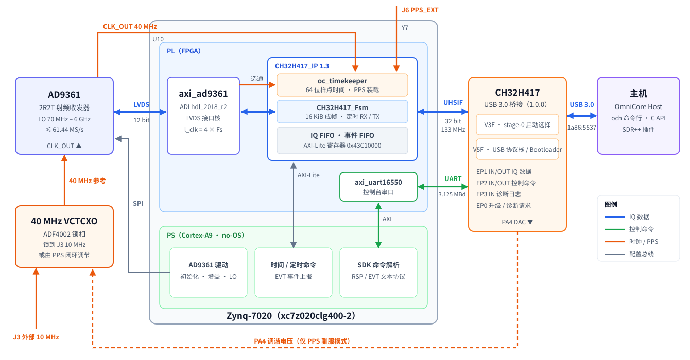

# OmniCore-SDR-Firmware

OmniCore SDR 的板端固件与下载工具仓库。OmniCore SDR 是一块基于 AD9361 + Zynq-7020 + CH32H417 的 USB 3.0 软件无线电，
2 收 2 发，最高 61.44 MS/s。本仓库包含：

- **Zynq-7020 + AD9361**：PL 逻辑（Vivado）及 PS 裸机软件（Xilinx SDK，no-OS + FSBL）。器件为 `xc7z020clg400-2`，工具版本为 **Vivado / SDK 2018.3**。
- **CH32H417 USB 3.0 桥接**：双核 RISC-V（V3F + V5F）固件，通过 UHSIF 连接 Zynq，使用 **MounRiver Studio 2 / RISC-V Embedded GCC15**。
- **FT2232 JTAG 配置工具**：Windows EEPROM 写入程序、FTDI .NET 库和 EEPROM 镜像，见 [工具说明](FIDI_EEPROM_Download_Tool/README.md)。

主机端驱动、命令行工具和 C API 在 [OmniCore-SDR-Host](https://github.com/Liren66/OmniCore-SDR-Host)（OCH）仓库。



各模块、时钟与接口的说明见 [docs/architecture.md](docs/architecture.md)。

## 功能

| 类别 | 说明 |
|---|---|
| 射频 | AD9361 2R2T（芯片 LO 范围 70 MHz – 6 GHz），采样率最高 61.44 MS/s；支持外部 RX/TX LO（J11/J10）、自定义 FIR、RX DC/IQ 跟踪校正 |
| 数据传输 | USB 3.0，每个 16 KiB 块带 16 字节头（序号、有效样点数、64 位时间戳），块内整数个样点；12 bit 或 IQ8 格式 |
| 吞吐 | 1RX、2RX、1T1R、2T2R IQ8 均为 61.44 MS/s；2T1R、1T2R 56 MS/s；2T2R 12 bit 42 MS/s（UHSIF 总线上限） |
| 时间与同步 | 64 位样点计数器；外部 PPS（J6）或内部 PPS 对时；定时 RX、定时 TX 突发；溢出丢样数精确可知；带时间的 TX 完成/迟到/欠流事件 |
| 参考时钟 | 板载 40 MHz VCTCXO；可由 ADF4002 锁到 J3 的外部 10 MHz，或由 CH32 按 PPS 闭环调节 |
| 固件升级 | CH32 桥接固件带 Bootloader，`och firmware update` 通过 USB 升级；Zynq 用 `BOOT.bin` 从 SD 卡或 QSPI 启动 |
| 板级 | RGB 状态灯、风扇温控、Zynq 温度、RSSI、数字接口自检 |

## 当前版本

**[v2026.11.07](https://github.com/Liren66/OmniCore-SDR-Firmware/releases/tag/v2026.11.07)**：Zynq 固件改为**成帧 USB 传输与硬件时间戳**
（FPGA `CH32H417_IP` 1.3、SDK `SDK_CMD_1.1_20261107_FRAMED`），原 16 KiB 递增起始头模式已删除。CH32 桥接固件仍为 **1.0.0**。

| 组件 | 版本 | 需要的 OmniCore Host |
|---|---|---|
| Zynq `BOOT.bin` | v2026.11.07（IP 1.3） | **0.6.0 及以上** |
| CH32 桥接 | 1.0.0 | USB 升级需 0.5.0 及以上 |

需要旧行为（OCH 0.5.x）请使用 v2026.11.03。历次版本与配套关系见 [更新记录](docs/changelog.md)。

## 文档

| 文档 | 内容 |
|---|---|
| [docs/architecture.md](docs/architecture.md) | 系统框图、数据通路、时钟、UHSIF 带宽、AXI 地址、中断、关键引脚 |
| [docs/hw-timestamps.md](docs/hw-timestamps.md) | 时间基准、成帧格式、定时 RX/TX、寄存器、多机同步、实测与吞吐对比 |
| [docs/sdk-commands.md](docs/sdk-commands.md) | 当前 SDK 命令、事务信封、异步事件、典型流程 |
| [docs/build.md](docs/build.md) | 仿真、IP 打包、位流、SDK、BOOT.bin、JTAG 加载、ILA 调试、发布清单 |
| [docs/changelog.md](docs/changelog.md) | 版本历史与固件 / 上位机配套表 |
| [OmniCore-SDR-Bridge/README.md](OmniCore-SDR-Bridge/README.md) | CH32 桥接固件：USB 端点、Flash 布局、Bootloader、升级协议 |
| [COMMAND_PROTOCOL_V1.txt](OmniCore-SDR-Firmware.sdk/COMMAND_PROTOCOL_V1.txt) | SDK 命令协议的历次扩展记录（含已删除的旧机制） |
| [FIDI_EEPROM_Download_Tool/README.md](FIDI_EEPROM_Download_Tool/README.md) | FT2232 JTAG 接口 EEPROM 配置 |

## 快速开始

1. 从 [Releases](https://github.com/Liren66/OmniCore-SDR-Firmware/releases) 下载同一版本的附件，核对 `SHA256SUMS.txt`。
2. 把 `BOOT.bin` 放到 SD 卡启动分区根目录（或写入 QSPI Flash）后上电。
3. 安装 [OmniCore Host](https://github.com/Liren66/OmniCore-SDR-Host/releases) 0.6.0 及以上，连接 USB 3.0 口，运行：

   ```bash
   och find
   och info
   ```

   `och info` 能打开设备，说明 Zynq 固件与上位机版本配套。
4. 运行 `och firmware info` 检查 CH32 桥接固件；低于当前版本时按下文升级。

## 下载与烧录

| 文件 | 对应器件 | 内容与使用方式 |
|---|---|---|
| `BOOT.bin` | Zynq-7020 | FSBL + FPGA 位流 + no-OS 应用（v2026.11.07 起为成帧传输，需 OmniCore Host 0.6.0+）。SD 启动时放在启动分区根目录，文件名保持 `BOOT.bin`；使用板上 Flash 启动时，通过 Xilinx SDK 的 Flash 编程流程写入。 |
| `Merge.bin` | CH32H417 | 完整 CH32 镜像：V3F stage-0（`0x0`）、V5F 应用（`0x20000`，头部在 `0x3FF00`）、V5F Bootloader（`0x40000`），间隙填充 `0xFF`。首次安装或更新 Bootloader 时用 WCH-Link 烧录，起始地址 `0x08000000`。 |
| `OmniCore-Bridge-<版本>.ocfw` | CH32H417 | 仅 V5F 应用的 USB 升级包（64 字节头 + 镜像，带 CRC）。设备已装 1.0.0 及以上固件时，运行 `och firmware update OmniCore-Bridge-<版本>.ocfw`（OmniCore Host 0.5.0+）。 |
| `FIDI_EEPROM_Download_Tool.zip` | FT2232 JTAG 接口 | Windows EEPROM 配置工具及配套文件，解压后按[工具说明](FIDI_EEPROM_Download_Tool/README.md)使用。 |
| `SHA256SUMS.txt` | 校验文件 | 固件镜像、升级包与工具压缩包的 SHA-256，用于确认下载文件完整。 |

各镜像分别用于对应芯片，不能互换。建议配套更新同一 Release 的镜像。
Windows 下可用 `Get-FileHash .\BOOT.bin, .\Merge.bin, .\*.ocfw, .\FIDI_EEPROM_Download_Tool.zip -Algorithm SHA256` 与校验文件比对。
早于 1.0.0 的 CH32 固件没有 Bootloader，需要先用 WCH-Link 烧一次 `Merge.bin`，之后即可走 USB 升级。

调试时也可以不写 SD/Flash，直接经 JTAG 把位流和程序加载到 RAM，掉电即恢复，见 [构建与调试](docs/build.md#8-jtag-加载到-ram不写-flash)。

### 升级 CH32 桥接固件

**第 1 步：确认设备当前固件。** 安装 [OmniCore Host](https://github.com/Liren66/OmniCore-SDR-Host/releases) 0.5.0 或更高版本，
关闭其他正在使用 SDR 的软件，然后运行：

```bash
och firmware info
```

| 显示 | 含义 | 下一步 |
|---|---|---|
| `Mode: application`，`Bootloader: 1.0.0` 或更高 | 已有 Bootloader | 直接做第 3 步 |
| `Mode: legacy`，或 `Bootloader: none` | 旧固件，或只烧过 MounRiver 调试镜像 | 先做第 2 步（只需一次） |
| `Mode: bootloader` | 设备停在 Bootloader（例如上次升级被中断） | 直接做第 3 步 |

**第 2 步（只需一次）：用 WCH-Link 烧录 `Merge.bin`。**

1. 将 WCH-Link 的 SWDIO/SWCLK 接到 CH32 的 PB9/PB8。这两个引脚同时是 Type-C 口的 USB2 D-/D+，
   需要使用把 D+/D- 引出到 WCH-Link 的线缆或测试点。
2. 用 MounRiver Studio 2 的下载工具或 WCH-LinkUtility，芯片选 CH32H417，文件选 `Merge.bin`，
   起始地址 `0x08000000`，下载并校验。从源码构建时也可在 `OmniCore-SDR-Bridge/` 中运行 `make flash`。
3. 桥接固件启动 3 秒后会把这两个引脚交给 USB2，WCH-Link 随之无法连接。已装 1.0.0 及以上固件时，
   先运行 `och firmware enter` 让设备进入 Bootloader（走 USB3 时不占用 SWD），再下载；
   旧固件需在上电后 3 秒内开始下载。
4. 下载完成后恢复正常的 USB 连接，运行 `och firmware info`，应显示 `Bootloader: 1.0.0`。

**第 3 步：通过 USB 升级。** 从 Release 下载 `OmniCore-Bridge-<版本>.ocfw`，运行：

```bash
och firmware update OmniCore-Bridge-<版本>.ocfw
```

依次显示 Entering bootloader、Erasing、Writing、Verifying、Restarting，约 5 秒后提示
`Bridge firmware <版本> installed.`。升级过程中不要拔线、断电或关闭窗口。
多台设备时加 `--serial <序列号>`（序列号见 `och find`）；`och firmware check FILE.ocfw` 可先离线校验文件。

**中断与恢复。**

- 升级中途断电、拔线或程序被关闭：重新连接后再执行一次 `och firmware update` 即可，设备会停在 Bootloader 等待。
- 设备停在 Bootloader、不想升级：运行 `och firmware boot` 回到原有应用。
- 设备处于 Bootloader 时，`och info` 和收发命令会提示先用 `och firmware`，这是正常现象。
- Windows 驱动和 Linux udev 规则无需改动：Bootloader 使用与应用相同的 USB 标识。

USB 设备标识为 `1a86:5537`：EP1 IN/OUT 传输 IQ 数据，EP2 IN/OUT 承载 USART1 控制通道，
EP3 IN 输出诊断信息。桥接固件、Bootloader 与 USB 升级协议详见 [Bridge README](OmniCore-SDR-Bridge/README.md)。

## 板上接口

| 接口 | 用途 |
|---|---|
| USB 3.0 Type-C | 数据与控制（CH32H417，`1a86:5537`） |
| J3 | 外部 10 MHz 参考输入（ADF4002 驯服板载 40 MHz） |
| J6 | 外部 PPS 输入（丝印 `10M_EXT`，实际网络为 `PPS_EXT`） |
| J10 / J11 | TX / RX 外部 LO 输入（频率为 2 × RF） |
| JTAG（FT2232） | Zynq 调试与下载；FT2232 的 EEPROM 配置工具在 `FIDI_EEPROM_Download_Tool/` |
| SD 卡 / QSPI | Zynq 启动镜像 `BOOT.bin` |

## 目录

```text
OmniCore-SDR-Firmware.xpr          Vivado 工程
OmniCore-SDR-Firmware.srcs/        block design（system.bd）、顶层 wrapper、约束（constrain.xdc）
ip_repo/adi/                       ADI hdl_2018_r2 IP（axi_ad9361 等）
ip_repo/user/CH32H417_IP/ip_repo/
  CH32H417_IP_1.0/                 自研 CH32H417_IP 1.3（UHSIF 成帧传输、时间基准）
    src/                           成帧状态机、时间基准、异步 FIFO、跨时钟域握手、FIFO Generator 子 IP
    hdl/                           IP 顶层与 AXI-Lite 寄存器
    drivers/                       SDK 驱动（BSP 生成时复制）
    sim/                           自检仿真（run_sim.sh，Vivado xsim）
    scripts/                       IP 重新打包（package_ip.tcl）
  BOARD_CTRL_AXI_1.0/              RGB 灯与风扇 PWM
scripts/
  build_time_base_bitstream.tcl    升级 BD 中的 IP、生成位流、导出 hdf 与报告
  jtag_run.tcl                     JTAG 加载位流与 ELF 到 RAM（不写 Flash）
docs/                              架构、时间戳、命令、构建与更新记录
OmniCore-SDR-Firmware.sdk/
  system_wrapper_hw_platform_0/    硬件平台（hdf、bitstream、ps7_init）
  OmniCore-SDR-no-OS/              AD9361 驱动、SDK 命令（src/console_commands/）和 bootimage/
  OmniCore-SDR-FSBL/               FSBL
  *_bsp/                           两个 BSP
  COMMAND_PROTOCOL_V1.txt          SDK 命令协议历次扩展记录
OmniCore-SDR-Bridge/
  UHSIF_DEVICE.wvsln               MounRiver Studio 2 解决方案（V3F、V5F，调试用）
  Makefile                         命令行构建三个镜像及 Merge.bin、.ocfw（发布用）
  V3F/                             V3F 核：stage-0，选择 V5F 启动应用还是 Bootloader
  V5F/                             V5F 核应用
  Boot/                            V5F Bootloader（USB 升级）
  Common/                          共用代码（USB 协议栈、ocfw 升级协议）、链接脚本、libUHSIF.a
  SRC/                             CH32H417 外设库、内核和启动文件
  tools/ocfw_pack.py               生成 .ocfw 升级包和 Merge.bin
FIDI_EEPROM_Download_Tool/         FT2232 JTAG EEPROM 配置程序、FTDI 库与镜像
```

## 重新编译

完整步骤（含仿真、IP 打包、ILA 调试与发布清单）见 [docs/build.md](docs/build.md)。简要流程：

### Zynq：BOOT.bin

1. **位流**：用 Vivado 2018.3 打开 `OmniCore-SDR-Firmware.xpr` 直接 Generate Bitstream，或在命令行运行
   `vivado -mode batch -source scripts/build_time_base_bitstream.tcl -tclargs <输出目录>`。
   IP 库路径为 `$PPRDIR/ip_repo/adi` 和 `$PPRDIR/ip_repo/user`；block design 的生成产物不在仓库中，构建时重新生成。
2. **SDK**：把新的位流和 hdf 导出到 `OmniCore-SDR-Firmware.sdk`，以该目录为工作区启动 SDK，
   通过 File → Import → Existing Projects 导入两个 BSP、FSBL、no-OS 共四个工程后编译。只改 SDK 代码时可跳过第 1 步。
3. **打包**：`OmniCore-SDR-no-OS/bootimage/output.bif` 依次打包 FSBL、`system_wrapper.bit` 和 no-OS 应用。
   BIF 中是绝对路径，clone 到其他位置后需先更新。在 SDK 中使用 Create Boot Image，或在已配置 Xilinx 工具环境的终端中运行：

```text
bootgen -image OmniCore-SDR-Firmware.sdk/OmniCore-SDR-no-OS/bootimage/output.bif -arch zynq -o BOOT.bin -w on
```

SDK 图形界面生成的镜像通常位于 `OmniCore-SDR-Firmware.sdk/OmniCore-SDR-no-OS/bootimage/BOOT.bin`。
打包和发布时请核对该镜像使用的三个输入文件，避免误用 SDK 工作区根目录中的旧副本。

### CH32H417：Merge.bin 与 .ocfw

发布镜像由命令行构建（需要已安装 MounRiver Studio 2 及 Python 3），在 Git Bash 中运行：

```bash
cd OmniCore-SDR-Bridge && make
```

`build/` 下生成 `Merge.bin`、`OmniCore-Bridge-<版本>.ocfw` 及三个核的 ELF/BIN。版本号在
`Common/fw_version.h`，构建号取自 `git describe`。`make flash` 用 WCH-Link 烧录 `Merge.bin`。

日常调试仍可用 MounRiver Studio 2 打开 `UHSIF_DEVICE.wvsln`（V3F、V5F 两个工程，`mate` 路径需指向本机检出位置）。
MRS 生成的 `V5F/obj/Merge.Bin` 不含 Bootloader 和应用头，只用于调试，不作为发布文件；
stage-0 遇到已编程的应用照常启动，因此调试下载不受影响。

## 版本管理与发布

原 OmniCore-SDR-Bridge 工程已移入本仓库的 `OmniCore-SDR-Bridge/`，作为普通源码目录维护，
不包含独立 Git 元数据，也不是子模块；Bridge 的历史没有合并到 Firmware 的 Git 历史中。Zynq 和 CH32 固件从本仓库统一发布。

`.runs`、`.cache`、`.ip_user_files`、block design 生成产物、SDK `.metadata`、`Debug/`、
Bridge 的 `obj/`、`build/`、`.mrs/`、IP 仿真目录 `sim/xsim_work/` 和本地 `dist/` 发布目录均被忽略。
`system_wrapper_hw_platform_0/system_wrapper.bit` 是打包输入，保留在仓库中。

预编译的 `BOOT.bin`、`Merge.bin`、`OmniCore-Bridge-<版本>.ocfw`、`FIDI_EEPROM_Download_Tool.zip` 及 `SHA256SUMS.txt` 通过 GitHub Release 附件分发。
Release 标签（`vYYYY.MM.DD`）对应统一源码版本；发布说明记录镜像来源、上位机版本要求及验证范围。

FT2232 工具以已有二进制及配套文件纳入 Git，本仓库尚未包含其应用程序源码。

## 许可证

本项目可由项目著作权人自主授权、且未另行注明许可的原创代码与文档，采用
**GNU General Public License v3.0 only（SPDX：`GPL-3.0-only`）**。
完整协议见 [LICENSE](LICENSE)。

第三方代码、库、工具及其衍生文件保留各自原有版权声明和许可条件；本项目的 GPL-3.0 声明
不替代这些条款，也不授予第三方材料原许可之外的权利。具体范围见
[第三方许可说明](THIRD_PARTY_NOTICES.md)。

部分第三方组件带有芯片使用限制，FT2232 工具也未附应用程序源码。因此，本次添加 GPL-3.0
不表示整个仓库及所有预编译附件已统一按 GPL-3.0 授权，或已完成组合固件的 GPL 兼容性确认。

## 第三方代码

- `ip_repo/adi/` 来自 [ADI hdl](https://github.com/analogdevicesinc/hdl) `hdl_2018_r2`，遵循其原许可证。
- 应用程序中的 AD9361 驱动（`ad9361*.c/h` 等）基于 ADI no-OS `2018_R2` 修改，保留并遵循其原版权声明。
- `OmniCore-SDR-Bridge/SRC/`、`Common/` 中部分代码及 `libUHSIF.a` 来自沁恒 CH32H417 EVT 例程，按其声明仅可用于沁恒生产的微控制器。
