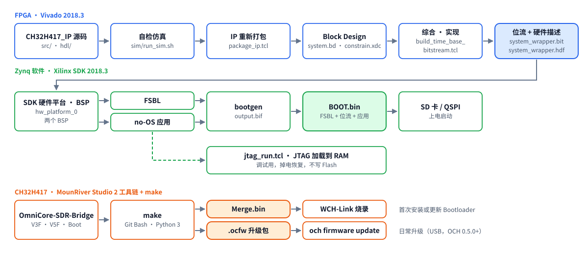

# 构建、仿真与调试

工具版本：**Vivado / SDK 2018.3**（器件 `xc7z020clg400-2`）；CH32 部分使用 **MounRiver Studio 2 / RISC-V Embedded GCC15**。
以下命令在 Windows 的 Git Bash 中运行，Xilinx 默认装在 `C:\app\Xilinx`；路径不同时请相应替换。

```bash
XIL=/c/app/Xilinx
export PATH="$XIL/Vivado/2018.3/bin:$XIL/SDK/2018.3/bin:$XIL/SDK/2018.3/gnu/aarch32/nt/gcc-arm-none-eabi/bin:$PATH"
```

## 1. 总流程



只改 SDK 代码时，从“编译 no-OS 应用”一步开始即可，不需要重新生成位流。

## 2. IP 仿真

`CH32H417_IP` 自带自检测试平台，覆盖时间设置、外部/内部 PPS、成帧 RX 与溢出、定时 RX、单通道与 IQ8、定时 TX：

```bash
bash ip_repo/user/CH32H417_IP/ip_repo/CH32H417_IP_1.0/sim/run_sim.sh
```

每一节打印 `=== X: ...`，最后一行为 `TB RESULT: PASS`，或 `TB RESULT: FAIL (<n> errors)`（失败项会在前面逐条打印）。
xsim 的退出状态不反映检查结果，自动化脚本请匹配这一行。
工作目录默认在 `sim/xsim_work/`（已被忽略），也可作为第一个参数传入。

测试平台中的 DAC 模型按 `axi_ad9361` 的真实取数时序建模（数据在 `dac_valid` 之前 2 个时钟被锁存）。修改 DAC 侧逻辑时不要去掉这一提前量。

## 3. 重新打包 IP

修改 `CH32H417_IP` 的端口、参数或文件列表后需要重新打包：

```bash
cd ip_repo/user/CH32H417_IP/ip_repo/CH32H417_IP_1.0/scripts
vivado -mode batch -source package_ip.tcl -tclargs <临时目录>
```

脚本合并新文件与端口，设置版本 1.3 并递增 `core_revision`，使主工程能识别到更新。只改已有 `.v` 文件的内容时，可跳过这一步，
直接在主工程中执行 IP 升级（下一步的脚本会做）。

## 4. 生成位流

```bash
vivado -mode batch -source scripts/build_time_base_bitstream.tcl -tclargs <输出目录> [并行任务数]
```

脚本会：

1. 打开 `OmniCore-SDR-Firmware.xpr`，刷新 IP 目录并升级 `CH32H417_IP_0`；
2. 检查 PPS 与 `AD9361_CLK_OUT` 连线，验证并保存 Block Design；
3. 生成 wrapper 和输出产物，运行综合、实现到位流；
4. 在输出目录写出 `system_wrapper.bit`、`system_wrapper.hdf`、`timing_summary.rpt`、`utilization.rpt`、`cdc.rpt`，并打印 `WNS=… WHS=…`。

脚本对已经是最新状态的工程是幂等的。也可以在 Vivado 图形界面中打开工程直接 Generate Bitstream，结果相同。

**时序检查**：`timing_summary.rpt` 中 WNS、WHS 都必须为非负。`rx_clk` 按 245.76 MHz（61.44 MS/s × 4）约束，这是最紧的时钟域。

## 5. 更新 SDK 硬件平台与 BSP

1. 把新的 `system_wrapper.bit` 复制到 `OmniCore-SDR-Firmware.sdk/system_wrapper_hw_platform_0/`，
   `system_wrapper.hdf` 复制为该目录下的 `system.hdf`，同时覆盖 `OmniCore-SDR-Firmware.sdk/system_wrapper.hdf`。
   也可在 Vivado 中用 File → Export → Export Hardware（勾选 Include bitstream）导出到 `.sdk` 目录。
2. 以 `OmniCore-SDR-Firmware.sdk` 为工作区启动 SDK。第一次使用时通过 File → Import → Existing Projects 导入两个 BSP、FSBL、no-OS 四个工程。
3. 硬件平台变化后，SDK 会提示更新 BSP。也可在命令行重新编译 BSP：

   ```bash
   make -C OmniCore-SDR-Firmware.sdk/OmniCore-SDR-no-OS_bsp
   ```

`CH32H417_IP` 的驱动源码有两份：IP 包内的 `drivers/` 和 BSP 的 `libsrc/CH32H417_IP_v1_0/`。修改驱动时两份要保持一致（文件为 CRLF 行尾）。

## 6. 编译 no-OS 应用

SDK 中 Build Project 即可。首次构建后，`Debug/` 下会生成 makefile，之后也可以在命令行增量编译：

```bash
make -C OmniCore-SDR-Firmware.sdk/OmniCore-SDR-no-OS/Debug all
```

新增源文件时，SDK 的托管构建会自动更新 `Debug/` 下的 `subdir.mk`；只用命令行时需要手动把文件加入对应目录的 `subdir.mk`。
`Debug/` 已被忽略，不进入仓库。

版本标识在 `src/console_commands/sdr_control.c` 的 `system_info?` 输出中（`firmware=SDK_CMD_…`），发布前请同步修改。

## 7. 打包 BOOT.bin

`OmniCore-SDR-no-OS/bootimage/output.bif` 依次列出 FSBL、位流和应用。BIF 使用绝对路径，clone 到其他位置后先修改为本机路径：

```text
//arch = zynq; split = false; format = BIN
the_ROM_image:
{
	[bootloader]<仓库>\OmniCore-SDR-Firmware.sdk\OmniCore-SDR-FSBL\Debug\OmniCore-SDR-FSBL.elf
	<仓库>\OmniCore-SDR-Firmware.sdk\system_wrapper_hw_platform_0\system_wrapper.bit
	<仓库>\OmniCore-SDR-Firmware.sdk\OmniCore-SDR-no-OS\Debug\OmniCore-SDR-no-OS.elf
}
```

```bash
bootgen -image OmniCore-SDR-Firmware.sdk/OmniCore-SDR-no-OS/bootimage/output.bif -arch zynq -o BOOT.bin -w on
```

SDK 图形界面的 Create Boot Image 生成的文件通常在 `OmniCore-SDR-no-OS/bootimage/BOOT.bin`。工作区根目录里可能残留旧的 `BOOT.bin`，发布前务必核对三个输入文件。

## 8. JTAG 加载到 RAM（不写 Flash）

调试时推荐直接经 JTAG 把位流和程序加载到 RAM，掉电即恢复原来的启动镜像：

```bash
xsct scripts/jtag_run.tcl \
    OmniCore-SDR-Firmware.sdk/system_wrapper_hw_platform_0/system_wrapper.bit \
    OmniCore-SDR-Firmware.sdk/system_wrapper_hw_platform_0/ps7_init.tcl \
    OmniCore-SDR-Firmware.sdk/OmniCore-SDR-no-OS/Debug/OmniCore-SDR-no-OS.elf
```

脚本依次执行系统复位、下载位流、`ps7_init`/`ps7_post_config`、下载 ELF 并运行，最后打印 `JTAG_RUN_OK`。
`no targets found` 表示没有找到 JTAG 目标：检查 JTAG 线和板子供电；新的 FT2232 接口还需先配置 EEPROM（见 [工具说明](../FIDI_EEPROM_Download_Tool/README.md)）。

程序完成 AD9361 初始化后，用 `och info` 确认设备能正常打开（OCH 0.6.0 会检查 `transport=framed16k`）；
`system_info?` 中的 `firmware=` 和 `fpga=CH32H417_IP_0x01030001` 应与预期一致。

## 9. 板上测试

需要已安装 OmniCore Host 0.6.0 及以上（OmniCore-SDR-Host 仓库）。

| 测试 | 命令 | 说明 |
|---|---|---|
| 时间戳 | `hw_timestamp_test [采样率]` | 计数速率、内部 PPS、PPS 装载、RX 时间戳连续、定时 RX、TX→RX 回环延迟、迟到突发。使用 AD9361 数据口回环，不需要射频线缆 |
| 吞吐 | `och bench ...` / `tools/bench_sweep.py` | 各通道配置的最高零错误采样率，对比表见 [hw-timestamps.md](hw-timestamps.md#11-吞吐对比windowsusb32026-11-07) |
| 数字接口 | `och action ...` 或命令 `digital_self_test!` | RX PRBS 与 TX 数字回环 |

## 10. 用 ILA 调试 PL

1. 在 Vivado 中打开综合后的设计，Set Up Debug，选择要观察的网络（例如 `CH32H417_Fsm` 的状态寄存器、FIFO 水位、`adc_valid`/`dac_valid`）。
   采样时钟选择网络所在的时钟域：成帧与时间逻辑用 `l_clk`，UHSIF 一侧用 `CH32H417_CLK`。
2. 保存约束时选择写入新的 XDC 文件，避免把调试核混进 `constrain.xdc`；调试结束后删除该文件即可恢复原设计。
3. 实现后用 `jtag_run.tcl` 加载新位流，再在 Hardware Manager 中 Refresh Device 并加载同目录生成的 `.ltx` 探针文件。

ILA 会占用 BRAM 并影响 245.76 MHz 域的时序，深度够用即可，加入后重新检查 WNS。

## 11. CH32H417 桥接固件

```bash
cd OmniCore-SDR-Bridge && make         # 生成 build/Merge.bin 与 OmniCore-Bridge-<版本>.ocfw
make flash                             # 用 WCH-Link 烧录 Merge.bin
```

版本号在 `Common/fw_version.h`，构建号取自 `git describe`。日常调试可用 MounRiver Studio 2 打开 `UHSIF_DEVICE.wvsln`。
详见 [Bridge README](../OmniCore-SDR-Bridge/README.md)。

## 12. 发布清单

1. 仿真全部 PASS，位流时序收敛（WNS、WHS ≥ 0）。
2. 更新 `system_info?` 中的固件标识；若 IP 版本变化，同步更新 `VERSION` 寄存器、测试平台和 OCH 的版本检查。
3. 硬件平台、BSP、应用重新编译，`bootgen` 生成 `BOOT.bin`。
4. 板上运行 `hw_timestamp_test` 和吞吐测试。
5. 在 `dist/<版本>/` 准备附件和 `SHA256SUMS.txt`：

   ```bash
   cd dist/<版本> && sha256sum BOOT.bin Merge.bin *.ocfw FIDI_EEPROM_Download_Tool.zip > SHA256SUMS.txt
   ```

6. 更新 README 的当前版本和 [changelog.md](changelog.md)，提交并打标签 `vYYYY.MM.DD`，推送后在 GitHub 创建 Release 并上传附件。
   发布说明写明对上位机版本的要求和验证范围。
